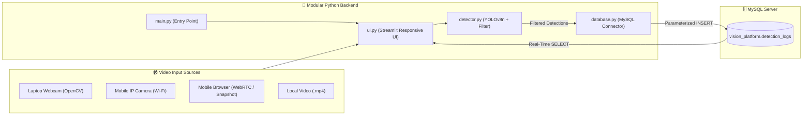

# 🚀 Real-Time Object Detection & Logging Platform (Desktop + Mobile)

A modular, real-time Computer Vision platform built with Python, OpenCV, Ultralytics YOLOv8, MySQL, and Streamlit. The platform captures live video feeds from a laptop webcam, a mobile phone camera over Wi-Fi, or local video files, filters detections by class and confidence score, logs events dynamically into a MySQL database (`vision_platform`), and visualizes real-time metrics on a mobile-responsive dashboard.

---

## 🏗️ Modular System Architecture



## Project File Structure

- `main.py` — Application entry point; resolves host Wi-Fi IP, caches the YOLOv8n model, initializes MySQL, and starts the UI.
- `detector.py` — Encapsulates `ObjectDetector` using `yolov8n.pt`, dynamic class/confidence filtering, and OpenCV bounding box rendering.
- `database.py` — Encapsulates `DatabaseManager` using `mysql-connector-python` and `python-dotenv` with per-class cooldown throttling.
- `ui.py` — Mobile-responsive Streamlit interface with QR code phone pairing, 4 camera modes, KPI cards, and live MySQL log table.
- `database_schema.sql` — SQL script to initialize `vision_platform` and the `detection_logs` table.
- `requirements.txt` — Python package dependencies.
- `.env.example` — Template for environment variables.

## ⚙️ Step-by-Step Setup Instructions

### 1. Clone the Repository & Create a Virtual Environment

```bash
git clone https://github.com/<your-username>/Real-Time-Object-Detection.git
cd Real-Time-Object-Detection

python -m venv venv
# Windows:
venv\Scripts\activate
# macOS / Linux:
# source venv/bin/activate

pip install -r requirements.txt
```

### 2. Set Up the MySQL Database (`vision_platform`)

Start your local MySQL server via XAMPP, WAMP, or MySQL Workbench.

Import `database_schema.sql` (or let `database.py` create the schema automatically on startup):

```bash
mysql -u root -p < database_schema.sql
```

### 3. Configure `.env` Credentials

Copy `.env.example` to `.env` and fill in your local MySQL credentials:

```bash
cp .env.example .env
```

Edit `.env`:

```ini
DB_HOST=localhost
DB_USER=root
DB_PASSWORD=your_mysql_password
DB_NAME=vision_platform
DB_PORT=3306

YOLO_MODEL_PATH=yolov8n.pt
```

### 4. Launch the Platform (Desktop & Mobile Wi‑Fi Access)

```bash
streamlit run main.py --server.address 0.0.0.0 --server.port 8501
```

## 📱 Mobile Setup Guide

### Opening the Dashboard on Your Phone

1. Connect your laptop and smartphone to the same Wi‑Fi network (or mobile hotspot).
2. Expand the "📱 Connect Your Mobile Phone" section at the top of the Streamlit dashboard.
3. Scan the on-screen QR code to open `http://<your-laptop-ip>:8501` directly in your mobile browser.

### Streaming Live Video from Your Mobile Camera

- Method 1: Mobile IP Camera Stream (Recommended for Highest FPS)
  - Install IP Webcam (Android) or DroidCam (iOS/Android) on your phone.
  - Start the server in the phone app and copy the stream URL.
  - Select the mobile IP stream mode in the dashboard and paste the URL.

- Method 2: Mobile Browser Live Camera (WebRTC)
  - Choose the mobile browser live camera mode.
  - Use the front or rear camera through the browser.

- Method 3: Mobile Camera Snapshot
  - Use the snapshot tool to analyze a photo taken directly from the phone camera.

## 📚 Learning Resources & Credits

- OpenCV & Python Full Course
- YOLO Object Detection with OpenCV & Python
- Python MySQL Connector Tutorial
- Streamlit Python UI Tutorial

---

## 2. Step-by-Step Local Execution, Mobile Network & Git Commands

Run these commands in your terminal to set up your environment, expose the app to your mobile phone on Wi‑Fi, and push the project to GitHub:

```bash
# 1. Create project folder and virtual environment
mkdir Real-Time-Object-Detection
cd Real-Time-Object-Detection
python -m venv venv

# Activate virtual environment (Windows PowerShell)
.\venv\Scripts\Activate.ps1
# Or on macOS / Linux:
# source venv/bin/activate

# 2. Install all required dependencies
pip install -r requirements.txt

# 3. Create your local .env file from .env.example
cp .env.example .env
# (Open .env in VS Code and set your MySQL root password)

# 4. Optional: Import the SQL schema manually (database.py also auto-creates it)
mysql -u root -p < database_schema.sql

# 5. (Windows Only) Allow port 8501 through Windows Firewall so your phone can connect over Wi-Fi
netsh advfirewall firewall add rule name="Streamlit_Mobile_8501" dir=in action=allow protocol=TCP localport=8501

# 6. Run the platform exposed to both Desktop (localhost) and Mobile (Wi-Fi IP)
streamlit run main.py --server.address 0.0.0.0 --server.port 8501
```

### Git & GitHub Upload Commands

```bash
# 1. Initialize Git repository
git init

# 2. Verify that .env is ignored and NOT staged
git status

# 3. Stage all modular project files
git add main.py detector.py database.py ui.py database_schema.sql requirements.txt .env.example .gitignore README.md

# 4. Commit the files
git commit -m "Feat: Complete modular Real-Time Object Detection & MySQL Logging Platform with mobile support"

# 5. Set main branch and push to your GitHub repository
git branch -M main
git remote add origin https://github.com/<your-username>/Real-Time-Object-Detection.git
git push -u origin main
```

## 3. 1–2 Minute Demo Video Script (Desktop + Mobile Showcase)

Use OBS Studio, Loom, or Windows Game Bar (Win + Alt + R) with your laptop screen split between the Streamlit dashboard (left 70%) and MySQL Workbench / phpMyAdmin (right 30%).

- 0:00 – 0:15 | Architecture & Security Intro
- 0:15 – 0:45 | Live Webcam Detection & Dynamic Filtering
- 0:45 – 1:15 | Mobile Phone Camera & Responsive UI Showcase
- 1:15 – 1:40 | Real-Time MySQL Verification

## 4. Complete Medium Article Draft (Ready to Publish)

Copy and paste the markdown below directly into a new story on Medium:

```markdown
Building a Real-Time Object Detection & MySQL Logging Platform with YOLOv8, OpenCV, and Streamlit (Desktop + Mobile)

Computer vision models are remarkably powerful on their own, but turning a raw neural network into a practical, real-world monitoring system requires more than just drawing bounding boxes on a video frame. A production-ready vision platform needs configurable filtering, persistent database logging, a clean modular architecture, and a responsive user interface that works seamlessly across both desktop and mobile devices.

In this article, I walk through how I built a complete Real-Time Object Detection & Event Logging Platform using Python, OpenCV, Ultralytics YOLOv8, MySQL, and Streamlit as part of my Computer Vision engineering workflow.

## 1. Introduction

The objective of this project was to build an end-to-end computer vision platform capable of:

- Capturing live video streams from a laptop webcam, a mobile phone camera over Wi‑Fi, or local video files.
- Running real-time object detection using Ultralytics YOLOv8 (`yolov8n.pt`).
- Allowing users to dynamically filter which object classes to track and adjust the minimum confidence threshold.
- Persisting every verified detection event into a local MySQL database (`vision_platform`).
- Visualizing the live annotated video feed and real-time database logs on a mobile-responsive Streamlit dashboard.

## 2. Computer Vision & YOLO Learning

Before building the full platform, I focused on mastering the two foundational pillars of the vision pipeline: OpenCV and Ultralytics YOLO.

### OpenCV Fundamentals

Using `cv2.VideoCapture`, OpenCV treats video streams as a continuous sequence of NumPy pixel arrays in BGR color space. Using `cv2.rectangle()` and `cv2.putText()`, we can overlay bounding boxes and confidence banners directly onto each frame in milliseconds.

### Single-Pass Detection with YOLOv8

YOLO (You Only Look Once) frames object detection as a single-pass regression problem, predicting bounding box coordinates, objectness scores, and class probabilities simultaneously. For this platform, I used YOLOv8 Nano (`yolov8n.pt`) pre-trained on the 80-class COCO dataset.

## 3. Application Development: Planning a Modular Architecture

A common pitfall in rapid prototyping is placing camera capture, deep learning inference, SQL queries, and UI rendering inside a single monolithic script. To keep the platform maintainable, testable, and scalable, I separated the application into four core Python modules:

- `main.py` — Application orchestrator and monitoring startup.
- `detector.py` — YOLOv8n + object filtering + frame annotation.
- `database.py` — MySQL connectivity + throttled detection logging.
- `ui.py` — Responsive dashboard with camera controls and metrics.

## 4. Database Integration: MySQL Event Logging

To persist detection events, I designed a relational schema in MySQL under the `vision_platform` database.

```sql
CREATE DATABASE IF NOT EXISTS vision_platform;
USE vision_platform;

CREATE TABLE IF NOT EXISTS detection_logs (
    log_id INT AUTO_INCREMENT PRIMARY KEY,
    timestamp DATETIME DEFAULT CURRENT_TIMESTAMP,
    object_class VARCHAR(100) NOT NULL,
    confidence FLOAT NOT NULL,
    bbox_x INT NOT NULL,
    bbox_y INT NOT NULL,
    bbox_w INT NOT NULL,
    bbox_h INT NOT NULL
);
```

## 5. User Interface: Building a Desktop & Mobile Dashboard with Streamlit

Using Streamlit, I designed a clean, wide-layout dashboard that works equally well on a desktop monitor and a smartphone screen:

- KPI summary row for total detections, current frame detections, and top detected object.
- Touch-friendly configuration panel for class filtering and confidence thresholds.
- QR code generator for mobile connection on the same Wi‑Fi network.

## 6. Challenges & Solutions

### Preventing MySQL Database Flooding at 30 FPS

A naive implementation would insert 30 identical rows every second. I resolved this by implementing a per-class cooldown barrier inside the database manager.

### Maintaining High Frame Rates on Mobile Camera Streams

Incoming frames wider than 640px are downscaled before YOLO inference to preserve real-time performance.

### Graceful Recovery from Dropped Camera Frames or DB Disconnects

I added resilient error handling for dropped video frames and missing database services to keep the app stable.

## 7. Final Result & Project Links

With all modules integrated, the platform smoothly detects objects in real time across desktop and mobile cameras, filters out low-confidence noise, logs structured bounding box telemetry to MySQL, and visualizes everything live on the dashboard.

- GitHub Repository: [Insert Your GitHub Repository Link Here]
- Demo Video: [Insert Your YouTube Unlisted / Google Drive Demo Video Link Here]
```
